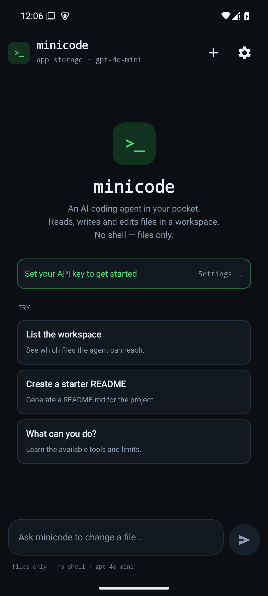
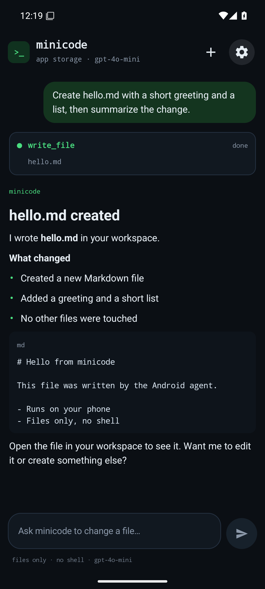
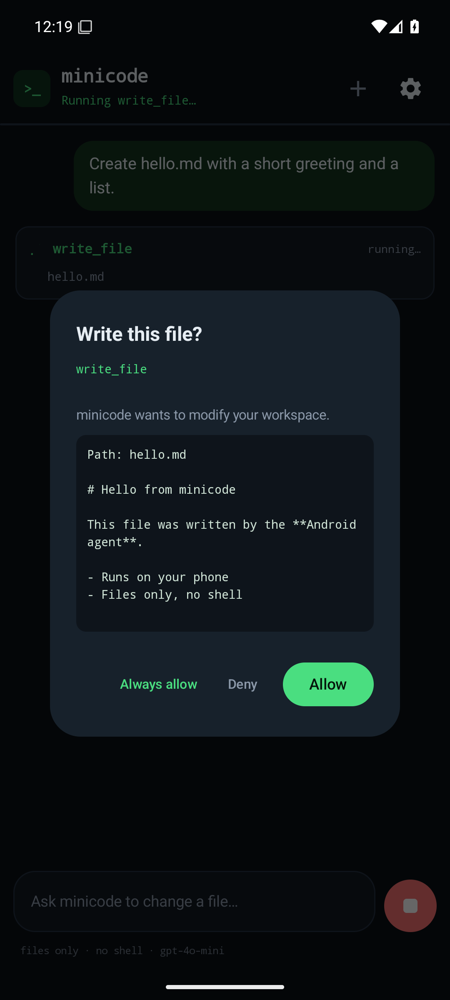
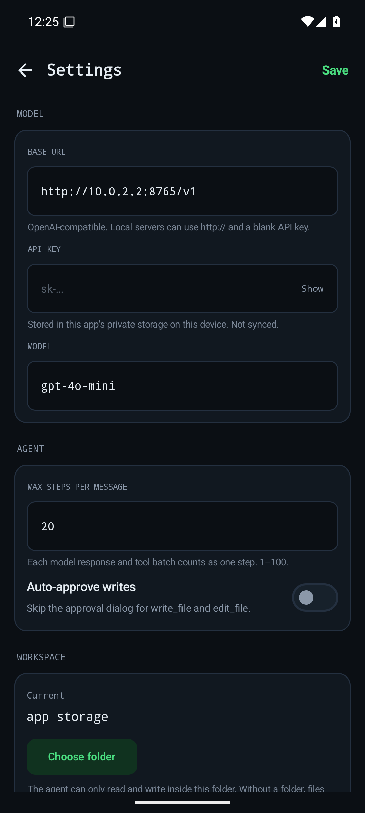
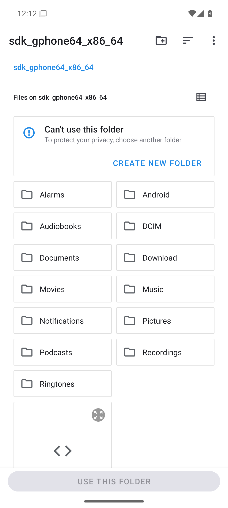
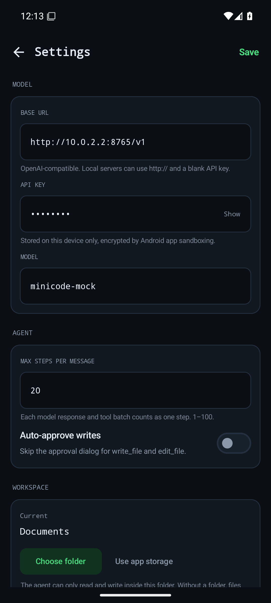

# minicode

A minimal, fast AI coding agent for your terminal and Android — the CLI is built with TypeScript and Bun, the Android app with Kotlin and Jetpack Compose. The CLI is distributed as a single binary from GitHub Releases.

> Hosted at [Fiesta1862/opencode](https://github.com/Fiesta1862/opencode). The application is called **minicode**; the repository name is historical and can be renamed later (GitHub keeps redirects).

```
  minicode
  model gpt-4o-mini · ~/projects/my-app
  /help for commands · Ctrl+C interrupts

› add a --verbose flag to the CLI and update the tests

⏺ I'll look at the current argument parsing first.
  ⚙ read src/cli.ts
  ✓ read src/cli.ts (142 lines)
  ⚙ edit src/cli.ts
    + const verbose = args.includes("--verbose");
    + if (verbose) console.log("verbose mode");
    Allow? y = once · a = always · n = no › y
  ✓ edited src/cli.ts +2 -0
⏺ Done. Added the flag and updated tests/cli.test.ts.
```

## Features

- **Terminal-native agent** — streaming responses, Markdown formatting, tool activity, and inline approval prompts.
- **OpenAI-compatible** — works with OpenAI, OpenRouter, Groq, Together, LM Studio, Ollama, vLLM, and anything else exposing `/v1/chat/completions`.
- **Real tools** — read, write, edit, glob, grep, list files, and run shell commands.
- **Safe by default** — file edits and commands require approval; paths are sandboxed to the current workspace, including symlink escapes.
- **Sessions** — conversations are saved automatically. Resume with `--continue` or `--session <id>`.
- **Single binary** — no Node, Bun, or `node_modules` required to run a release build. glibc and musl (Alpine) builds included.
- **Alpine packages** — installable `.apk` packages for `x86_64` and `aarch64`.
- **Native Android app** — Kotlin/Compose client with the same agent loop and file tools. Files only: no shell, builds, or tests on the phone.
- **Scriptable** — `minicode run "..."` for one-shot tasks, with a read-only-by-default policy unless `--yes` is passed.
- **No runtime dependencies** — the CLI and its TUI are implemented with the standard library.

## Install

From GitHub Releases (Linux x64/arm64 — glibc and musl, macOS x64/arm64, Windows x64):

```bash
curl -fsSL https://github.com/Fiesta1862/opencode/releases/latest/download/install.sh | sh
```

The installer downloads the right binary, verifies its SHA-256 checksum, and installs to `~/.local/bin`.

To install somewhere else (remember: variables go on the `bash` side of the pipe):

```bash
curl -fsSL https://github.com/Fiesta1862/opencode/releases/latest/download/install.sh | MINICODE_INSTALL_DIR="$HOME/bin" sh
```

Pin a version:

```bash
curl -fsSL https://github.com/Fiesta1862/opencode/releases/latest/download/install.sh | MINICODE_VERSION=0.1.2 sh
```

Or download the asset for your platform directly from the [releases page](https://github.com/Fiesta1862/opencode/releases).

### Alpine Linux

Alpine uses musl, so dedicated `linux-*-musl` binaries and `.apk` packages are included. On a minimal system, install `curl` first (`apk add curl`), then either run the installer (it detects Alpine automatically) or install the package directly:

```bash
curl -fSLO https://github.com/Fiesta1862/opencode/releases/latest/download/minicode-0.1.2-r0.x86_64.apk
sudo apk add --allow-untrusted ./minicode-0.1.2-r0.x86_64.apk
minicode --version
```

Use `aarch64` instead of `x86_64` on 64-bit ARM. The package is built with Alpine's `abuild` and signed with a throwaway key generated during the release build, so `--allow-untrusted` is required. Compare its SHA-256 with `checksums.txt` to verify the download. The package pulls `libstdc++` automatically, which is the only shared-library dependency of the Bun musl binary. The curl installer also installs `libstdc++` when run as root on Alpine; for non-root installs run `apk add libstdc++` first.

> **Alpine `.apk` files are Linux packages, not Android apps.** Android cannot install them and reports *"There was a problem while parsing the package."* Use the native Android app below instead.

### Android app

A native Kotlin/Jetpack Compose client lives in [`android/`](android/). It runs the same OpenAI-compatible agent loop on the phone, with file tools and approval prompts. It does **not** have a shell: no commands, builds, or tests.

Download and install the signed APK (Android 8.0 / API 26 or newer):

```bash
curl -fL -o minicode-android.apk \
  https://github.com/Fiesta1862/opencode/releases/download/v0.1.2/minicode-android-0.1.0.apk
adb install minicode-android.apk
```

You can also download the APK on the phone and tap it, allowing installs from your browser or file manager when Android asks.

**Setup**

1. Open **minicode → Settings**.
2. Enter an OpenAI-compatible **base URL** (default `https://api.openai.com/v1`), **API key**, and **model**. Local servers can use `http://` and a blank key.
3. Optionally choose a **workspace folder** with Android's folder picker. Without one, files live in app-private storage.
4. Ask the agent to read, create, or edit files. Writes and edits ask for approval unless auto-approve is enabled.

<table>
  <tr>
    <td></td>
    <td></td>
    <td></td>
  </tr>
  <tr>
    <td align="center">Home</td>
    <td align="center">Streaming agent + tool activity</td>
    <td align="center">Write approval</td>
  </tr>
  <tr>
    <td></td>
    <td></td>
    <td></td>
  </tr>
  <tr>
    <td align="center">Model settings</td>
    <td align="center">Workspace picker</td>
    <td align="center">Folder-backed workspace</td>
  </tr>
</table>

The Android app stores conversations as JSON in app-private storage and keeps the API key in the app's private preferences. It is signed with a project release key; future updates must be signed with the same key.

## Quick start

```bash
export OPENAI_API_KEY=sk-...
minicode
```

For a local OpenAI-compatible server (e.g. Ollama):

```bash
export MINICODE_BASE_URL=http://localhost:11434/v1
export MINICODE_API_KEY=local
export MINICODE_MODEL=qwen2.5-coder:7b
minicode
```

> The base URL should include the API version prefix, usually `/v1`. For OpenAI the default is already `https://api.openai.com/v1`.

## Usage

```text
minicode                     Start an interactive session
minicode run [prompt]        Run one task and exit (reads stdin if no prompt)
minicode sessions            List saved sessions for this directory
minicode config              Show the resolved configuration
```

Useful options:

```text
-m, --model <name>           Model to use (default: gpt-4o-mini)
    --base-url <url>         OpenAI-compatible API root
    --api-key <key>          API key (prefer OPENAI_API_KEY)
    --max-steps <n>          Max model turns per message (default: 25)
-y, --yes                    Auto-approve file edits and commands
-c, --continue               Resume the most recent session here
-s, --session <id>           Resume a specific session
-h, --help                   Show help
-v, --version                Show the version
```

Examples:

```bash
minicode run "where is rate limiting implemented?"
minicode run --yes "fix the failing tests"
git diff | minicode run "review this change for bugs"
echo "explain src/agent.ts" | minicode
minicode --continue
```

### Interactive commands

| Command | Description |
| --- | --- |
| `/help` | Show commands |
| `/model [name]` | Show or change the model |
| `/clear` | Start a new session |
| `/config` | Show resolved configuration |
| `/exit` | Quit |

Press `Ctrl+C` once to interrupt a running response, twice to exit. Approval prompts accept `y` (once), `a` (always for this tool this session), or `n`.

## Tools

| Tool | Approval | Description |
| --- | --- | --- |
| `read_file` | no | Read a text file, with offset/limit |
| `write_file` | **yes** | Create or overwrite a file |
| `edit_file` | **yes** | Replace an exact string; shows a diff before approval |
| `list_files` | no | Indented directory tree |
| `glob` | no | Find files by pattern |
| `grep` | no | Search file contents by regex |
| `run_command` | **yes** | Run a shell command (120s default timeout, stdin closed) |

All paths are resolved inside the workspace. `node_modules`, `.git`, and binary files are skipped by the search tools. Long tool output is truncated before it is sent back to the model.

## Safety

- **Approvals:** edits and commands require confirmation unless you pass `--yes` or set `auto_approve` in config. In non-interactive `run` mode without `--yes`, actions are denied automatically.
- **Workspace sandbox:** paths that escape the working directory are rejected, including through symlinks.
- **No hidden network access:** the agent can still run commands that use the network if you approve them. Only run it in repositories you trust.
- **Not a security boundary:** approval screens reduce accidents, not a determined attacker. Review commands before approving.

## Configuration

Precedence, highest first:

1. CLI flags
2. Environment variables
3. `./minicode.json` (project)
4. `~/.config/minicode/config.json` (global)
5. Defaults

Example `minicode.json` (see `minicode.json.example`):

```json
{
  "model": "gpt-4o-mini",
  "base_url": "https://api.openai.com/v1",
  "max_steps": 25,
  "temperature": 0.2,
  "auto_approve": false,
  "system_prompt_extra": "Prefer functional style. Run bun test after changes."
}
```

Environment variables:

| Variable | Purpose |
| --- | --- |
| `OPENAI_API_KEY` / `MINICODE_API_KEY` | API key |
| `OPENAI_BASE_URL` / `MINICODE_BASE_URL` | API root |
| `MINICODE_MODEL` | Default model |
| `MINICODE_MAX_STEPS` | Default max steps |
| `MINICODE_AUTO_APPROVE` | `1` to auto-approve |
| `MINICODE_DATA_DIR` | Session storage (default `~/.local/share/minicode`) |
| `MINICODE_CONFIG_DIR` | Global config directory |
| `NO_COLOR` | Disable ANSI colors |

Sessions are stored as JSON under `~/.local/share/minicode/sessions/` and are scoped to the directory they were created in.

## Development

Requires [Bun](https://bun.sh) 1.2+.

```bash
bun install
bun run dev            # run from source
bun test               # unit + mock-server integration tests
bun run typecheck      # tsc --noEmit
bun run build          # binary for the current platform -> dist/
bun run build:all      # all release targets (cross-compiles, including musl)
bun run package:apk    # Alpine .apk packages from the musl binaries (needs Docker)
```

The build injects the version from `package.json` and produces `dist/minicode-<os>-<arch>` plus `checksums.txt`.

`package:apk` runs Alpine's `abuild` inside an `alpine:3.20` container to produce signed `x86_64` and `aarch64` packages. It requires Docker and the musl binaries from `build:all`. The generated packages are added to `dist/checksums.txt`.

### Android app

Requires JDK 17+ and Android SDK platform 35 with build-tools 35.0.0. Point `android/local.properties` at the SDK (`sdk.dir=/path/to/android-sdk`), then:

```bash
cd android
./gradlew app:testDebugUnitTest
./gradlew app:assembleDebug     # app/build/outputs/apk/debug/app-debug.apk
./gradlew app:assembleRelease   # signed when keystore.properties is present
```

Release signing reads `android/keystore.properties` and the keystore it points at; both are gitignored. Without them, `assembleRelease` produces an unsigned APK. Keep that keystore safe: Android requires the same signing key for future updates.

### Publishing a release

On GitHub, with this repository pushed to `Fiesta1862/opencode`:

```bash
git tag v0.1.2
git push origin v0.1.2
```

`.github/workflows/release.yml` runs type checks and tests, cross-compiles every target, builds the Alpine packages, generates checksums, and attaches the binaries, `.apk` packages, and `install.sh` to the GitHub Release. The `ci.yml` workflow runs on pushes and pull requests.

If you rename the repository or fork it, update the default `REPO` in `install.sh` (or set `MINICODE_REPO=owner/repo` when installing).

## Project layout

```text
src/
  cli.ts              argument parsing, commands, help
  agent.ts            model/tool loop and system prompt
  llm.ts              OpenAI-compatible streaming client
  config.ts           flags/env/files resolution
  session.ts          JSON session persistence
  tools/              read, write, edit, glob, grep, list, shell
  ui/                 ANSI styling, streaming renderer, approvals
tests/                unit + mock-server integration tests
scripts/build.ts        cross-platform binary builds
scripts/package-apk.ts  Alpine .apk driver (Docker)
scripts/apk-inner.sh    abuild packaging inside Alpine
install.sh              release installer
android/                native Android app (Kotlin + Jetpack Compose)
  app/src/main/java/com/fiesta1862/minicode/
    agent/              agent loop, approvals, system prompt
    llm/                OpenAI-compatible SSE client
    tools/              read, write, edit, list, glob, grep
    workspace/          app storage + Storage Access Framework
    ui/                 chat, settings, Markdown renderer, theme
```

## Limitations

- No automatic context compaction yet; very long sessions eventually hit the model's context window.
- Approvals are per tool call (or per tool for `always`); there is no granular per-path policy yet.
- Markdown rendering is intentionally lightweight.
- Shell commands run with your user permissions.
- Windows shell execution uses PowerShell; Unix uses `bash`/`sh`.
- The Android app has no shell or `run_command` tool by design: it can only read, write, edit, list, glob, and grep files. Builds and tests still need the CLI on a computer.
- On Android, folders outside the selected workspace are inaccessible unless you pick them through the system folder picker.

## License

MIT
